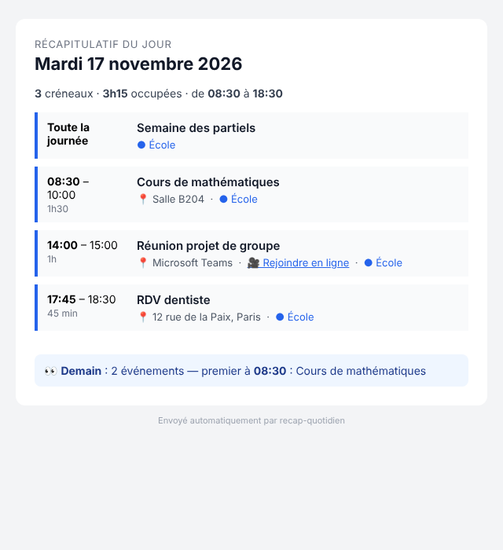

# Automatisation

Petites automatisations du quotidien.

| Automatisation | Pour qui | Où ça tourne |
|---|---|---|
| [1. Récap quotidien de ma journée](#1-récapitulatif-quotidien-de-la-journée-par-e-mail) | Moi | GitHub Actions + Gmail |
| [2. Récap hebdo des agendas des collègues](recap_hebdo_entreprise/GUIDE.md) | Utilisateurs en entreprise, sans droits admin | Power Automate (Microsoft 365) |

## 1. Récapitulatif quotidien de la journée par e-mail

Chaque matin, un mail récapitule les cours, réunions et rendez-vous de la journée
(lus depuis un ou plusieurs calendriers Outlook / école au format ICS), avec un aperçu
du lendemain.



**Fonctionnement** : GitHub Actions lance `recap_quotidien/recap.py` tous les jours à
6h (heure de Paris, 7h en été). Le script télécharge les calendriers, garde les
événements du jour (y compris les cours récurrents, en ignorant les cours annulés)
et envoie le mail. Rien à installer sur ton ordinateur.

### Étape 1 — Récupérer le lien ICS de ton calendrier Outlook

Le plus simple est de publier ton calendrier Outlook (qui contient aussi ton
calendrier d'école si tu l'y as importé/abonné) :

1. Va sur [outlook.office.com](https://outlook.office.com) (ou outlook.live.com pour un compte perso).
2. ⚙️ **Paramètres** → **Calendrier** → **Calendriers partagés**.
3. Dans **Publier un calendrier**, choisis le calendrier, puis **Peut afficher tous les détails** → **Publier**.
4. Copie le lien **ICS** (il se termine par `calendar.ics`).

> Si ton école te fournit directement un lien `.ics` ou `webcal://`, tu peux l'utiliser tel quel.
> Si tu as plusieurs calendriers (école, perso…), récupère un lien pour chacun.

⚠️ Ce lien donne accès à ton agenda : ne le partage pas et ne le mets jamais dans le code,
uniquement dans les *secrets* GitHub (étape 3).

### Étape 2 — Créer un mot de passe d'application pour l'envoi du mail

Le mail est envoyé via un compte Gmail (le plus fiable, Microsoft ayant restreint
l'envoi SMTP par mot de passe sur Outlook.com) :

1. Active la validation en deux étapes sur ton compte Google si ce n'est pas déjà fait.
2. Va sur <https://myaccount.google.com/apppasswords>, crée un mot de passe nommé « Recap ».
3. Copie les 16 caractères générés.

Le mail peut ensuite être envoyé **vers n'importe quelle adresse**, y compris ton adresse Outlook.

### Étape 3 — Ajouter les secrets dans GitHub

Dans le dépôt GitHub : **Settings** → **Secrets and variables** → **Actions** → **New repository secret**.

| Nom | Valeur |
|---|---|
| `ICS_URLS` | Un calendrier par ligne, au format `Nom\|lien`, par ex. :<br>`École\|https://outlook.office365.com/owa/calendar/.../calendar.ics`<br>`Perso\|https://.../calendar.ics` |
| `SMTP_USER` | ton adresse Gmail |
| `SMTP_PASSWORD` | le mot de passe d'application (étape 2) |
| `MAIL_TO` | l'adresse qui reçoit le récap (plusieurs possibles, séparées par des virgules) |
| `SMTP_HOST` / `SMTP_PORT` | *(optionnel)* par défaut `smtp.gmail.com` / `587` |

### Étape 4 — Tester

Onglet **Actions** → **Récap quotidien** → **Run workflow**. Le mail arrive en
quelques secondes. Ensuite, il sera envoyé automatiquement chaque matin.

### Personnaliser

- **Heure d'envoi** : modifie la ligne `cron` dans `.github/workflows/recap-quotidien.yml`
  (elle est en heure UTC : `0 5 * * *` = 6h à Paris en hiver). GitHub peut parfois
  décaler l'envoi de quelques minutes.
- **Mise en forme** : tout est dans la fonction `construire_mail` de `recap_quotidien/recap.py`.

### Tester en local (optionnel)

```bash
cd recap_quotidien
pip install -r requirements.txt
ICS_URLS="École|test_exemple.ics" python recap.py --date 2026-11-17 --dry-run
```

`--dry-run` n'envoie rien et génère `apercu.html` à ouvrir dans le navigateur.
Retire `--dry-run` (et définis les variables de `.env.example`) pour envoyer pour de vrai.

### Bon à savoir

- Sur un dépôt **public**, GitHub suspend les tâches planifiées après 60 jours sans
  activité sur le dépôt : un mail d'avertissement est envoyé, il suffit de cliquer
  pour réactiver. Les dépôts privés ne sont pas concernés.
- Si un calendrier est inaccessible, le mail est quand même envoyé avec les autres,
  et un avertissement est affiché en bas du mail.
