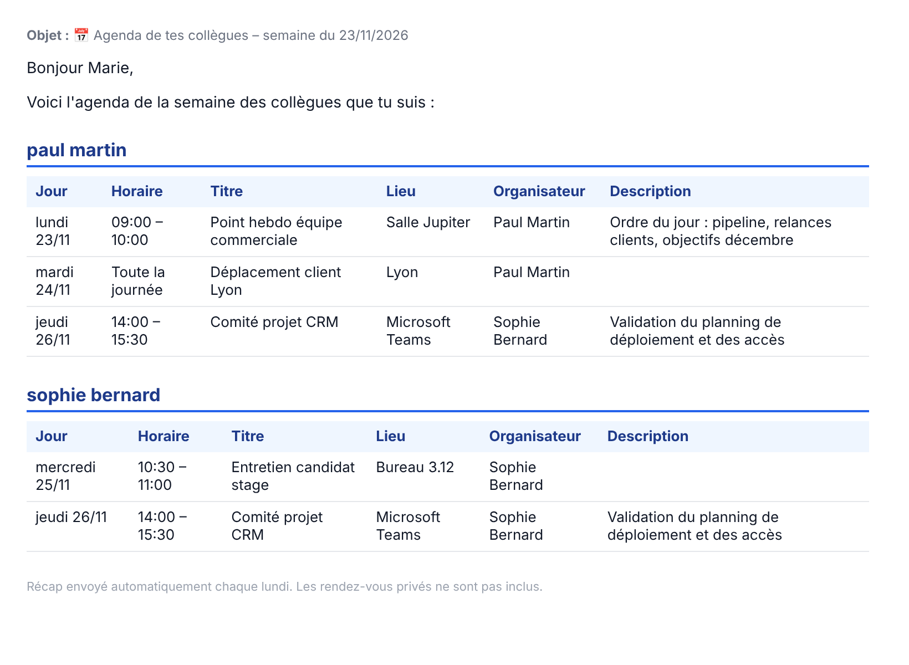

# Récap hebdo des agendas des collègues (entreprise, sans droits admin)

Chaque **lundi à 7h**, chaque personne inscrite reçoit un mail avec l'agenda de la
semaine (lundi → vendredi) **des collègues qu'elle suit** : jour, horaire, titre,
lieu, organisateur et début de la description.



## Pourquoi cette solution

| Contrainte | Réponse |
|---|---|
| Pas de droits admin sur les PC | Rien n'est installé : tout tourne dans **Power Automate** (cloud Microsoft 365, accessible depuis le navigateur). |
| Pas d'aide du service informatique | On n'utilise que des fonctions ouvertes à tout utilisateur : **partage de calendrier Outlook** + connecteurs **standard** de Power Automate. Aucune application à faire valider. |
| Toi qui gères qui suit qui | Un seul fichier Excel central : `abonnements.xlsx`. |
| Données de l'entreprise | Tout reste dans Microsoft 365 : les mails partent de la boîte Outlook professionnelle, pas d'un service externe. |

**Principe** : un seul flux Power Automate, appartenant à un compte de l'entreprise
(le tien ou un compte dédié, appelé ci-dessous **le compte du flux**). Chaque collègue
partage son calendrier avec ce compte. Le lundi, le flux lit le fichier Excel et, pour
chaque destinataire, interroge les calendriers des collègues suivis, puis envoie le mail.

> ⚠️ Avant de se lancer : vérifie que tu as accès à <https://make.powerautomate.com>
> avec ton compte d'entreprise. Power Automate est inclus dans la plupart des
> abonnements Microsoft 365 entreprise, mais certaines entreprises le désactivent.
> Dans ce cas, aucune solution n'est possible sans le service informatique.

---

## Étape 0 — Faire un test pilote d'abord

Fais d'abord tout le guide avec **1 destinataire (toi) et 1 collègue**. Une fois le
mail reçu correctement, ajoute les autres lignes dans l'Excel : le flux n'a pas besoin
d'être modifié.

## Étape 1 — Les collègues partagent leur calendrier

> **En clair, avec un exemple.** Toi (*alex@entreprise.fr*) crées le flux : c'est donc
> **ton** compte qui est le compte du flux. Tu veux recevoir l'agenda de *Julie*
> (*julie@entreprise.fr*). Alors :
> 1. **Julie** partage son calendrier avec **alex@entreprise.fr**, en « Peut afficher tous les détails ».
> 2. **Toi**, tu acceptes l'invitation reçue par mail. Le calendrier de Julie apparaît dans ton
>    Outlook : vérifie que tu vois bien les titres de ses rendez-vous, pas seulement « Occupé ».
> 3. Dans l'Excel : `Destinataire` = alex@entreprise.fr, `Prenom` = Alex, `Collegues` = julie@entreprise.fr.
>
> Plus tard, si *Marc* veut aussi recevoir l'agenda de Julie, Julie n'a rien de plus à faire :
> elle a déjà partagé avec le compte du flux. Tu ajoutes simplement une ligne pour Marc dans l'Excel.

Chaque collègue **suivi par au moins une personne** doit partager son calendrier avec
le compte du flux, une seule fois :

- **Outlook (web ou nouveau Outlook)** : Calendrier → clic droit sur « Calendrier » →
  **Partage et autorisations** → saisir l'adresse du compte du flux → choisir
  **Peut afficher tous les détails** → **Partager**.
- **Outlook classique** : Accueil → **Partager le calendrier** → **Ajouter** → l'adresse
  → autorisation **Peut afficher tous les détails** → OK.

Le compte du flux reçoit une invitation par mail : clique sur **Accepter**.

Les événements que le collègue marque **Privé** 🔒 ne sont **jamais** inclus dans le récap.

Message type à envoyer aux collègues :

> Bonjour,
> Pour mettre en place le récap hebdo des agendas de l'équipe, peux-tu partager ton
> calendrier Outlook avec **compte.du.flux@entreprise.fr** en « Peut afficher tous les
> détails » ? (Outlook → Calendrier → clic droit sur « Calendrier » → Partage et autorisations.)
> Les titres, horaires, lieux et descriptions de tes rendez-vous de la semaine seront
> envoyés chaque lundi aux personnes suivantes : … . Tes rendez-vous marqués « Privé »
> ne seront jamais inclus. Tu peux arrêter le partage à tout moment.

> 🔐 **RGPD** : les agendas contiennent des données personnelles. Informe clairement
> chaque collègue de qui reçoit son agenda (comme dans le message ci-dessus) et
> ne l'ajoute qu'avec son accord. Ne l'ajoute dans la colonne « Collegues » que pour
> les personnes listées dans le message.

## Étape 2 — Déposer le fichier Excel central

1. Ouvre **OneDrive** avec le compte du flux, crée un dossier `Recap`.
2. Dépose `abonnements.xlsx` (fourni dans ce dossier) dedans.
3. Remplace les lignes d'exemple par les vraies :

| Destinataire | Prenom | Collegues |
|---|---|---|
| marie.durand@entreprise.fr | Marie | paul.martin@entreprise.fr;sophie.bernard@entreprise.fr |

- Une ligne = une personne qui reçoit le récap.
- `Collegues` = adresses séparées par `;`, sans espaces superflus.
- Les données doivent rester **dans le tableau Excel nommé `Abonnements`** (le flux ne
  lit que ce tableau). Pour ajouter une ligne, appuie sur **Tab** dans la dernière cellule.
- Garde les titres de colonnes **sans accents** (`Prenom`, `Collegues`).

Pour gérer le fichier toi-même alors que le flux appartient à un autre compte,
partage-toi le fichier en modification depuis OneDrive.

## Étape 3 — Créer le flux dans Power Automate

Sur <https://make.powerautomate.com>, connecté avec le compte du flux :
**+ Créer** → **Flux de cloud planifié**.

- Nom : `Recap hebdo agendas`
- Démarrage : la date de lundi prochain, 07:00
- Répéter tous les : `1` `Semaine`, cocher **L** (lundi) → **Créer**.

Ouvre ensuite le déclencheur **Périodicité (Recurrence)** et vérifie :
Fuseau horaire = **(UTC+01:00) Bruxelles, Copenhague, Madrid, Paris**, À ces heures = `7`,
À ces minutes = `0`.

> **Comment saisir une expression** : clique dans le champ, puis sur l'icône **fx**
> (« Insérer une expression »), colle le texte, puis **Ajouter**.
> **Renommer une action** : clique sur son titre en haut du panneau. Les noms donnés
> ci-dessous sont importants, car les expressions y font référence (un espace devient `_`).

Ajoute ensuite les actions suivantes **dans cet ordre** (bouton **+** sous la précédente).

### 3.1 — Début et fin de la semaine

**Opérations sur les données → Composer (Compose)**, renommée **`Debut`** :

```
convertToUtc(startOfDay(convertFromUtc(utcNow(), 'Romance Standard Time')), 'Romance Standard Time', 'yyyy-MM-ddTHH:mm:ssZ')
```

**Composer**, renommée **`Fin`** (5 jours = lundi → vendredi ; mets 7 pour inclure le week-end) :

```
addDays(outputs('Debut'), 5, 'yyyy-MM-ddTHH:mm:ssZ')
```

### 3.2 — Variable qui contiendra le contenu du mail

**Variables → Initialiser la variable (Initialize variable)** :
Nom = `html`, Type = **Chaîne (String)**, Valeur = vide.

### 3.3 — Lire le fichier Excel

**Excel Online (Business) → Répertorier les lignes présentes dans un tableau (List rows present in a table)**,
renommée **`Lire abonnements`** :
Emplacement = **OneDrive for Business**, Bibliothèque = **OneDrive**,
Fichier = `/Recap/abonnements.xlsx`, Tableau = **Abonnements**.

### 3.4 — Boucle sur chaque destinataire

**Contrôle → Appliquer à chacun (Apply to each)**, renommée **`Pour chaque destinataire`**.
Champ « Sélectionner une sortie » : expression

```
body('Lire_abonnements')?['value']
```

> Ne pas activer le **contrôle d'accès concurrentiel** (parallélisme) sur les deux boucles
> « Appliquer à chacun » : elles doivent s'exécuter une itération à la fois, car elles
> partagent la variable `html`. C'est le réglage par défaut.

**Dans** cette boucle, ajoute :

**a) Variables → Définir la variable (Set variable)** : Nom = `html`, Valeur = expression

```
concat('<p>Bonjour ', items('Pour_chaque_destinataire')?['Prenom'], ',</p><p>Voici l''agenda de la semaine des collègues que tu suis :</p>')
```

**b) Contrôle → Appliquer à chacun**, renommée **`Pour chaque collegue`**, sortie =

```
split(trim(items('Pour_chaque_destinataire')?['Collegues']), ';')
```

**c) Après** la boucle `Pour chaque collegue` (toujours dans `Pour chaque destinataire`) :
**Office 365 Outlook → Envoyer un e-mail (V2) (Send an email (V2))**, renommée **`Envoyer recap`** :

- À : expression `items('Pour_chaque_destinataire')?['Destinataire']`
- Objet : expression
  ```
  concat('📅 Agenda de tes collègues – semaine du ', formatDateTime(convertFromUtc(utcNow(), 'Romance Standard Time'), 'dd/MM/yyyy'))
  ```
- Corps : expression
  ```
  concat('<style>body{font-family:Segoe UI,Arial,sans-serif;font-size:14px;color:#111827}h3{color:#1e3a8a;margin:24px 0 8px;border-bottom:2px solid #2563eb;padding-bottom:4px}table{border-collapse:collapse;width:100%;font-size:13px}th{background:#eff6ff;color:#1e3a8a;text-align:left;padding:6px 8px}td{border-bottom:1px solid #e5e7eb;padding:6px 8px;vertical-align:top}</style>', variables('html'), '<p style="color:#9ca3af;font-size:11px;margin-top:24px">Récap envoyé automatiquement chaque lundi. Les rendez-vous privés ne sont pas inclus.</p>')
  ```
- Dans **Paramètres → Configurer l'exécution après (Run after)** de cette action : coche
  **a réussi** ET **a échoué** sur `Pour chaque collegue`, pour que le mail parte même
  si un agenda n'est pas accessible.

### 3.5 — Dans la boucle « Pour chaque collegue »

Ajoute, **dans cet ordre** :

**1. Composer**, renommée **`Email collegue`** :

```
trim(items('Pour_chaque_collegue'))
```

**2. Office 365 Outlook → Envoyer une requête HTTP (Send an HTTP request)**, renommée **`Lire agenda`** :

- URI : expression
  ```
  concat('https://graph.microsoft.com/v1.0/users/', outputs('Email_collegue'), '/calendar/calendarView?startDateTime=', outputs('Debut'), '&endDateTime=', outputs('Fin'), '&$top=200&$orderby=start/dateTime&$select=subject,start,end,location,organizer,bodyPreview,isAllDay,isCancelled,sensitivity')
  ```
- Méthode : `GET`
- CustomHeader1 (dans « Paramètres avancés ») : `Prefer: outlook.timezone="Romance Standard Time"`

**3. Opérations sur les données → Filtrer un tableau (Filter array)**, renommée **`Evenements visibles`** :
De = expression `body('Lire_agenda')?['value']`, puis **Modifier en mode avancé** et colle :

```
@and(equals(item()?['isCancelled'], false), equals(item()?['sensitivity'], 'normal'))
```

(retire les événements annulés et les événements privés)

**4. Opérations sur les données → Sélectionner (Select)**, renommée **`Lignes`** :
De = expression `body('Evenements_visibles')`, puis dans **Mapper** ajoute ces paires
(clé à gauche en texte, valeur à droite en expression) :

| Clé | Valeur (expression) |
|---|---|
| `Jour` | `formatDateTime(item()?['start/dateTime'], 'dddd dd/MM', 'fr-FR')` |
| `Horaire` | `if(item()?['isAllDay'], 'Toute la journée', concat(formatDateTime(item()?['start/dateTime'], 'HH:mm'), ' – ', formatDateTime(item()?['end/dateTime'], 'HH:mm')))` |
| `Titre` | `item()?['subject']` |
| `Lieu` | `item()?['location/displayName']` |
| `Organisateur` | `item()?['organizer/emailAddress/name']` |
| `Description` | `item()?['bodyPreview']` |

**5. Opérations sur les données → Créer une table HTML (Create HTML table)**, renommée **`Table HTML`** :
De = expression `body('Lignes')`, Colonnes = **Automatique**.

**6. Variables → Ajouter à la variable chaîne (Append to string variable)**, renommée **`Ajouter collegue`** :
Nom = `html`, Valeur = expression

```
concat('<h3>', replace(first(split(outputs('Email_collegue'), '@')), '.', ' '), '</h3>', if(empty(body('Lignes')), '<p><i>Aucun événement cette semaine.</i></p>', body('Table_HTML')))
```

**7. Variables → Ajouter à la variable chaîne**, renommée **`Agenda inaccessible`**,
placée **en parallèle** de `Evenements visibles` (le **+** sous `Lire agenda` → « Ajouter une branche parallèle ») :
Nom = `html`, Valeur = expression

```
concat('<h3>', outputs('Email_collegue'), '</h3><p style="color:#b91c1c">⚠️ Agenda non accessible : vérifier que ce collègue a bien partagé son calendrier avec le compte du flux.</p>')
```

Puis **Paramètres → Configurer l'exécution après** : décoche « a réussi », coche
**a échoué** et **a expiré** sur `Lire agenda`.

**Enregistrer.**

### Récapitulatif de la structure

```
Périodicité (lundi 7h, Paris)
├─ Debut
├─ Fin
├─ Initialiser la variable html
├─ Lire abonnements (Excel)
└─ Pour chaque destinataire
   ├─ Définir la variable html (Bonjour …)
   ├─ Pour chaque collegue
   │  ├─ Email collegue
   │  ├─ Lire agenda (requête HTTP Graph)
   │  ├─ ┬─ Evenements visibles → Lignes → Table HTML → Ajouter collegue
   │  │  └─ Agenda inaccessible   (seulement si Lire agenda échoue)
   └─ Envoyer recap   (après réussite OU échec de « Pour chaque collegue »)
```

## Étape 4 — Tester

1. Bouton **Tester** → **Manuellement** → **Tester** → **Exécuter le flux**.
2. Ouvre l'exécution : chaque action doit être verte ✅. Clique sur `Lire agenda`
   pour voir ce que Microsoft a renvoyé.
3. Vérifie le mail reçu.

| Problème | Cause probable |
|---|---|
| `Lire agenda` en erreur **403 / ErrorAccessDenied** | Le collègue n'a pas partagé son calendrier avec le compte du flux, ou l'invitation n'a pas été acceptée. |
| `Lire agenda` en erreur **404 / ErrorItemNotFound** | Adresse mal écrite dans l'Excel, ou partage pas encore actif (attendre quelques minutes après l'acceptation). |
| Titres vides ou « Occupé » seulement | Le partage est en « Peut voir quand je suis occupé » : il faut **Peut afficher tous les détails**. |
| Horaires décalés d'une heure | L'en-tête `Prefer: outlook.timezone="Romance Standard Time"` manque dans `Lire agenda`. |
| `Lire abonnements` en erreur | Le fichier a été déplacé ou renommé, ou les données ne sont plus dans le tableau `Abonnements`. |
| Le flux ne trouve pas une colonne | Le titre de colonne a été modifié (il doit rester exactement `Destinataire`, `Prenom`, `Collegues`). |

## Au quotidien

- **Ajouter une personne ou un abonnement** : modifier l'Excel seulement.
- **Nouveau collègue suivi** : lui demander de partager son calendrier (étape 1), puis l'ajouter dans l'Excel.
- **Le compte du flux** doit rester actif : si la personne quitte l'entreprise, le flux s'arrête.
  Ajoute un **copropriétaire** (page du flux → Modifier les propriétaires) pour ne pas le perdre.
- Power Automate prévient par mail si le flux échoue plusieurs fois de suite.
